# Milestone 9.6 — Generation responsiveness and multiplayer stability

## Pre-implementation audit

Recorded before implementation. Generated crisis preparation starts at mission start, or after the host's successful `/continue` acknowledgement of a finalized result. Votes resolve under the state lock; consequences, metrics, and immutable public history are committed together. Narrative memory is derived from these results by `build_context`, not updated speculatively. No upcoming crisis is pre-generated during `decision_locked` result review. All players must be connected for the host to continue; individual player acknowledgements are not required.

`LiveGeneration.launch_pending` captures the bounded privacy-filtered request and deterministic fallback under the state lock. A single task keyed by mission/attempt runs provider inference and strict validation outside that lock. Admission verifies the pending attempt, target index, phase, and snapshot uniqueness under lock, persists before publication, then broadcasts outside the state lock. The 100 ms scheduler and reconnect cannot duplicate the active task. Accepted outcomes are retained in memory on transient admission storage failure, without repeating inference.

The provider's existing total timeout selects deterministic authored fallback. Disconnect does not cancel preparation: admission can finish with players offline, but discussion is gated on reconnection. Shutdown cancels pending tasks; restart resolves persisted pending preparation using authored fallback without replaying provider inference. Already admitted snapshots and roles restore unchanged. Host acknowledgement of crisis 10 completes the mission; early metric collapse ends it before another crisis request.

```mermaid
sequenceDiagram
    participant H as Host / players
    participant S as Authoritative server
    participant G as Background generation
    H->>S: Final votes
    S->>S: Resolve; apply consequences; persist history
    S-->>H: decision_locked: review result
    Note over H,G: No next-crisis inference during this review
    H->>S: Host continue, every seat connected
    S->>S: Persist preparing attempt; capture final context
    S->>G: Schedule once; release state lock
    S-->>H: preparing status
    G->>G: Await provider; validate or deterministic fallback
    G->>S: Guard attempt; admit and persist
    S-->>H: briefing snapshot
    Note over H,S: Browser rendering is not measured by server timestamps
```

The provider duration lies on the next-crisis critical path after host acknowledgement. The prior real 20.569–32.142 second measurements covered provider/service time, not browser waiting or rendering. Existing UI announces preparation but hides the active gameplay component when no crisis is projected. Earlier generation would require allowing pending/prepared content during `decision_locked`, buffering snapshots, separating admission from presentation, and extending persistence/restart invariants currently restricted to `preparing`. This milestone will preserve those invariants and progression gates; no speculative pre-generation lifecycle is introduced. A safer improvement is retaining the already recorded public result during preparation.

## Implementation and measurement boundaries

Two narrowly scoped production changes:

1. `LiveGeneration` accepts an injected monotonic clock, defaults to `perf_counter`, and emits sanitized `crisis_lifecycle` records through the existing backend logger. The most recent 100 samples are available only in-process at `app.state.generation.lifecycle`. No public endpoint or snapshot field was added. Persisted outcome diagnostics, their local read-only inspection CLI, legacy serialization, SQLite schema, and accepted-result immutability remain unchanged.
2. During `preparing`, the React gameplay area now renders the **already recorded public result**, its executed choice, consequences and metric impact. The backend already projects that result. It displays no future crisis, private intelligence, vote controls or progression button. The existing preparation/unavailable announcements and backend admission gates remain in place. This avoids losing useful reading material during an unavoidable wait; it does not reduce model latency.

No model, prompt, provider settings, retry policy, validation, voting, metric calculation, or production WebSocket code changed. The revised Stage B continuity prompt is retained.

### Timeline and instrumentation

```mermaid
flowchart LR
    A[Schedule pending attempt] -->|queue_seconds| B[Generation service starts]
    B -->|Existing provider / validation / fallback measurements| C[Outcome ready]
    C -->|admission_seconds: lock wait + storage retries + commit| D[Admission persisted]
    D -->|publication_seconds: server broadcast completes| E[Server sends complete]
    E -. Receipt / rendering not observed by server .-> F[Client receives and renders]
```



| Interval | Measurement | Boundary / limitation |
| --- | --- | --- |
| Provider adapter | Existing private `measurement.provider_seconds` | Full adapter call, not inference-only or network-only time |
| Generation | Existing outcome duration; new `generation_seconds` | Provider plus validation/fallback; one process monotonic clock |
| Queue | New `queue_seconds` | First scheduling to first execution; storage retries do not relabel previous inference as queue time |
| Admission | New `admission_seconds` | Outcome ready to return from guarded admission/persistence; includes lock contention and retained-outcome storage retry delay |
| Server preparation | New `server_preparation_seconds` | Scheduling to admission/commit, not exact client waiting; can include time players are disconnected |
| Publication | New `publication_seconds` | Admission return to completion of ordered server broadcasts; does not imply receipt/rendering |
| Actual player-ready waiting | Production field remains `null` | Server has no observation of a person's readiness or browser presentation; no misleading subtraction of unrelated clocks |
| Correlated local client waiting | New loopback smoke stopwatch | One client-process clock from readiness just before HTTP action to all three WebSocket briefing receipts |
| Browser rendering | Remains `null` | No browser presentation probe was added |

Scheduling is timestamped after bounded context/fallback capture; host HTTP processing and that synchronous capture are not included in `server_preparation_seconds`. The correlated client receipt probe includes them.

Intervals stay process-local: no monotonic timestamp is persisted or compared across processes/restarts. Samples contain only crisis number, status/source, numeric intervals, and explicit unknowns. They exclude mission/player/session identifiers, prompts, intelligence, vote contents, chat, credentials and provider payloads. On restart these runtime samples are lost; previous immutable provider/outcome diagnostics remain available. Retaining an outcome across a transient persistence failure retains its original ready timestamp and performs no new inference. Logging is developer-only; private measurements do not become gameplay fields.

### Critical path and deliberate scope choice

There is still **no overlap with pre-acknowledgement result review**. A speculative prefetch would require a new buffered-content lifecycle and revised persisted generation invariants. That is a larger architectural change than a safe responsiveness correction and would need dedicated design for restart, stale context, final victory and admission gates. This milestone intentionally preserves those rules. Players can now continue reading the recorded result during preparation after acknowledgement; that interval can overlap background inference without changing when inference starts or when the next crisis appears.

When an admitted briefing is already available and every player is connected, starting discussion waits for no provider task. Other missions' discussion/voting deadlines continue advancing while inference is pending; provider work never holds the state lock. A slow network broadcast is measured separately from inference.

## WebSocket stall investigation

### Evidence before correction

The exact historical tests were repeated in bounded subprocesses:

- `backend/tests/test_foundation.py::test_sync_privacy_multitab_disconnect_and_reconnect`
- `backend/tests/test_campaign.py::test_ten_crisis_multiplayer_campaign_with_ties_privacy_reconnect_and_once_only[2]`
- The same campaign test with `[3]` and `[4]`.

Each batch runs these four cases; the seven-second subprocess boundary and three-second faulthandler capture prevent indefinite hangs.

| Batch | Runs | Successful batches | Failures | Timeouts |
| --- | ---: | ---: | ---: | ---: |
| Original harness with tracing | 6 | 6 | 0 | 0 |
| Original harness, uninstrumented | 10 | 9 | 0 | 1 |
| Managed harness, initial repetition | 10 | 10 | 0 | 0 |
| Managed harness, verbose repetition | 10 | 10 | 0 | 0 |
| Final managed harness | 10 | 10 | 0 | 0 |

The original uninstrumented tenth run stalled in campaign `restore` → `states` → `receive_json`, awaiting the presence broadcast after a secondary tab closed. The saved stack does not retain the active parametrization value, so no unsupported attribution to a specific player count is made. Tracing changed timing enough that its six runs did not reproduce the issue. Baseline evidence and summaries are under `docs/evidence/milestone_9_6/ws-before*`; later batches are preserved separately.

### Demonstrated cause and correction

Installed Starlette `WebSocketTestSession.__exit__` executes exit callbacks in this order: queue `websocket.disconnect`, cancel the ASGI cancel scope, then wait for the session future. The endpoint's `finally` removes the socket under the state lock and awaits a broadcast outside that lock. Immediate test-scope cancellation can interrupt that final broadcast. Tests that then synchronously wait for exactly that frame hang; this is an in-process test teardown race, not evidence that inference holds the state lock or that real sockets require changed behavior.

`test_stock_testclient_cancels_disconnect_publication` reproduces this deterministically using the actual endpoint and an event gate at its cleanup broadcast. With stock TestClient, cancellation interrupts the broadcast and no surviving-client frame is received within a bounded check. The corresponding managed-session test delivers the frame and verifies cleanup completed without cancellation. No arbitrary synchronization sleeps are used: the gate represents a possible scheduling/lock delay. A third regression bounds silent receives; a fourth bounds a cleanup operation that genuinely fails to finish.

The test-only `ManagedWebSocketSession` waits up to three seconds for the ASGI handler to finish after delivering disconnect, then runs the original stream/portal cleanup. Receives are bounded too, with only recent frame categories, safe phase labels, ASGI completion state and pending task count in failure diagnostics. A conftest fixture applies it to existing TestClient WebSockets. Tests, assertions and expected messages are retained; no test is disabled and no global timeout is enlarged. Production WebSocket behavior is untouched.

The controlled cancellation mechanism matches the missing-cleanup-frame symptom and was corrected. It cannot prove every historical timeout had that cause. Thirty successful post-correction batches (120 parametrized target-case executions) and clean full suites provide bounded evidence, not a guarantee against every future intermittent defect. The existing Starlette/httpx deprecation warning remains; no dependency migration was attempted.

## Concurrency and recovery evidence

The focused final run passed **59 tests** across responsiveness, harness, existing live generation and durable diagnostic tests. Existing safeguards were reused rather than duplicated:

| Required behavior | Evidence |
| --- | --- |
| Pending generation while reading resolved crisis | Injected-clock benchmark preserves the prior public result through preparation; frontend renders it without intents |
| Multiple progression requests | Existing host-only acknowledgement/idempotency plus new repeated acknowledgements/concurrent scheduler launches |
| One/all players disconnect during inference | New controlled-event tests, both reconnect-before and reconnect-after completion variants |
| Reconnect keeps identity/roles/content without new inference | New role/privacy assertions; existing three-client HTTP/WS and local-network recovery tests |
| Timeout/failure | Existing real async total-timeout regression plus new injected-delay timeout/unavailable fallback cases |
| Restart with pending generation | Existing pending first/next-crisis shutdown/restart tests and killed-process smoke use authored recovery without replay |
| Restart after admission | Existing snapshot, role, voting, immutable resolution hash tests and real-process restart smoke |
| Stale/duplicate completion | Existing attempt/index/phase guards, full campaign tests and duplicate acknowledgement checks |
| Final victory / early defeat | Existing ten-generated-crisis and collapse tests verify no extra crisis inference |
| Private isolation / final context | New and existing per-role projections; finalized metrics, selected choice, consequence and derived bounded memory assertions |
| State-lock independence | New test advances another mission through discussion/voting expiration while a provider is held by an event |
| Storage retry timing | New test retains the ready timestamp through a ten-second simulated storage outage with one inference only |
| Legacy compatibility | Existing diagnostics/persistence tests pass; persisted record shapes and migrations are unchanged |

The old Stage B protocol's offline tests initially failed because its historical seal correctly rejected the newly changed sources. Those two tests now use a temporary current-source manifest, and a new regression proves changes to that seal still stop execution. The actual historical live harness and archived manifests were not changed. It continues to refuse source drift; this is not renewed authorization to execute that batch.

## Performance evidence

### Previously measured real provider — unchanged baseline

Milestone 9.5 Stage B measured 32.142, 28.301, 23.567 and 20.569 seconds; p50 25.933683 seconds. Provider adapter time accounted for almost all generation duration and validation was below one millisecond. These are **previous measurements**, not new results or a measurement of browser waiting. The underlying split among inference, provider scheduling, reasoning and networking remains unproven. The exploratory 15-second provider target has **not** been established.

### New offline controlled-clock simulation

All cases use finalized authoritative Crisis 1 decisions, ten simulated seconds of result review, the existing production service/admission pathways and fake providers. Clocks advance without waiting in real time. No real provider calls occur.

| Fake provider | Generation seconds | Simulated server-ready-to-admission wait | Review/inference overlap before acknowledgement | Additional provider wait after admission | Source |
| --- | ---: | ---: | ---: | ---: | --- |
| Immediate | 0 | 0 | 0 | 0 | Generated |
| 5 seconds | 5 | 5 | 0 | 0 | Generated |
| 15 seconds | 15 | 15 | 0 | 0 | Generated |
| 30 seconds | 30 | 30 | 0 | 0 | Generated |
| Timeout | 60 | 60 | 0 | 0 | Deterministic authored fallback |
| Failure after 5 seconds | 5 | 5 | 0 | 0 | Deterministic authored fallback |

These measurements prove accounting and lifecycle behavior under the specified synthetic schedule. They do not predict network latency or reduce real-model duration. The timeout simulation raises the production timeout category after advancing the clock; the separate existing held-provider test actually exercises the async timeout/cancellation boundary. Simulated admission/publication costs are zero unless explicitly advanced. A contention test independently measures 2.5 seconds of admission lock delay and 0.25 seconds of publication delay.

### Actual loopback client receipt timing, fake provider

A real Uvicorn process, isolated SQLite database, three HTTP/WS clients, and an intentional 50 ms fake-provider delay produced:

- Initial ready-to-all-three-briefing-receipts: **0.076327 seconds**.
- Next-crisis ready-to-all-three-briefing-receipts: **0.080473 seconds**.
- The pending snapshot retained the recorded outcome and hid the next crisis; common content was checked after admission.

Each interval uses the **same client-process monotonic clock** before the HTTP intent and after receipt of the correlated briefing state. It includes HTTP processing, local persistence, scheduling and socket receipt. It does not measure browser rendering, real LLM performance, or a cross-machine clock difference. This is one local observation, not a latency distribution or a performance target claim.

## Verification and commands

Final results:

- Complete backend: **634 passed**, one existing Starlette/httpx deprecation warning, 20.46 seconds.
- Focused generation/lifecycle/harness/durable diagnostics: **59 passed**, same warning, 2.12 seconds.
- Frontend with freshly captured review/expansion/chat/restart snapshots: **109 passed, 0 skipped**, 295.83 ms. The initial default invocation passed 105 and skipped the four optional snapshot tests; the final invocation exercised all four.
- TypeScript type-check, production build, Python `pip check`, frontend `npm ls --depth=0`, and whitespace checks: passed.
- Existing persistence/restart, generation, endgame, campaign, frontend reconnect, review and expansion local-network smokes: all passed. Captured-chat acceptance and the new correlated receipt smoke passed.
- Three post-correction bounded reconnect batches: **30 successes, 0 failures, 0 timeouts**. Original uninstrumented baseline: **9 successes, 0 failures, 1 timeout**; instrumented baseline: **6 successes, 0 failures, 0 timeouts**.
- An earlier full run completed with 627 passes and two historical-source-seal unit-test failures (not a WebSocket stall). The corrected run passed 632; the final run passed 634 after adding two further negative/retry regressions. These are separate runs, not combined counts.
- Zero paid or real-provider requests. All generated content in new tests/smokes came from explicit fake providers. No optimization of provider requests was attempted.

Run from repository root unless a directory is specified:

```bash
# Full suite; outer bound guards any failures outside bounded socket receives.
timeout 90 .venv/bin/python -m pytest backend/tests -q -o faulthandler_timeout=15

.venv/bin/python -m pytest backend/tests/test_generation_responsiveness.py backend/tests/test_websocket_harness.py backend/tests/test_live_generation.py backend/tests/test_durable_generation_diagnostics.py -q -x

# Fresh output directory is required for each repetition batch.
.venv/bin/python backend/tests/repeat_websocket_tests.py --output /tmp/ce96-ws-recheck --runs 10 --timeout 7
.venv/bin/python backend/tests/measure_responsiveness.py --output /tmp/ce96-simulated.json
.venv/bin/python backend/tests/smoke_responsiveness.py --output /tmp/ce96-receipt.json

# Existing network/captured-data checks, executed sequentially where ports overlap:
.venv/bin/python backend/tests/smoke_milestone7.py
.venv/bin/python backend/tests/smoke_live_generation.py
.venv/bin/python backend/tests/smoke_adaptive_narrative.py
.venv/bin/python backend/tests/smoke_milestone5.py
node --experimental-websocket frontend/tests/smokeReconnection.mjs
.venv/bin/python backend/tests/smoke_milestone6.py
.venv/bin/python backend/tests/smoke_milestone8.py
.venv/bin/python backend/tests/test_chat_acceptance.py

# In frontend/ after the captured-data checks:
npm test
MISSION_REVIEW_FILE=/tmp/ce-m6-live.json EXPANSION_REVIEW_FILE=/tmp/ce-m8-live.json CHAT_ACCEPTANCE_FILE=/tmp/ce-chat-5-1.json MISSION_RESTART_FILE=/tmp/ce-m7-restart.json npm test
npm run typecheck
npm run build
npm ls --depth=0

# Repository root:
.venv/bin/python -m pip check
git diff --check
```

Smokes were bounded to 60 seconds each (65 seconds for the additional review/expansion/chat group); the new receipt smoke had a 30-second bound. Repeated subprocess commands, exact test IDs, outcomes and sanitized logs are saved under the evidence directory. The original pre-change repetition helper and trace plugin are also retained as text for reproducibility. No raw snapshot files with private role information are included in the evidence archive.

## Exact change inventory

Production:

- `backend/app/generation/live.py` — injected monotonic timing, retained ready timestamps, bounded sanitized lifecycle samples/logs.
- `frontend/src/Gameplay.tsx` — retained public consequence panel during preparation, without controls.

Tests/tools:

- `backend/tests/conftest.py` — apply the managed test session.
- `backend/tests/ws_harness.py` — bounded receive, graceful ASGI completion, bounded cleanup diagnostics.
- `backend/tests/test_websocket_harness.py` — raw cancellation reproduction, corrected cleanup, receive and cleanup failure bounds.
- `backend/tests/test_generation_responsiveness.py` — concurrency, final context, timing, isolation and storage retry regressions.
- `backend/tests/measure_responsiveness.py` — controlled fake-provider timeline evaluation.
- `backend/tests/repeat_websocket_tests.py` — reproducible bounded repetitions with safe logs.
- `backend/tests/smoke_responsiveness.py` — real loopback correlated client receipt timing using fake inference.
- `backend/tests/test_stage_b_revalidation_protocol.py` — isolated offline test seals; historical live guard remains unchanged.
- `frontend/tests/gameplay.test.tsx` — public-result retention without future content or progression controls.

Documentation/evidence:

- `docs/MILESTONE_9_6_RESPONSIVENESS.md` — this report, including the pre-change audit.
- `docs/evidence/milestone_9_6/` — preservation hashes, before/after repetition logs and summaries, sanitized verification logs, simulation and local receipt measurements, command results, inventory and checksums. `inventory.json` enumerates every added/changed file and each evidence artifact; `SHA256SUMS.json` seals the final packet.

All **35 existing acceptance/preparation artifacts** remain byte-identical to their pre-milestone hashes. Original Stage A and Stage B acceptance artifacts, development reports and preparation manifests were not overwritten. The only production files differing from the historical Stage B source seal are the two intended production changes listed above. Source seal differences are expected for a new milestone; historical records were not reinterpreted.

## Remaining limitations and next recommendation

The demonstrated TestClient teardown race is corrected and bounded, with no remaining observed stall in the tested post-change runs. Keep the negative reproduction and repeated tests in use: these results do not prove that every historical or future timeout has the same cause. Managed sessions use Starlette's test-session internals and should be checked on dependency upgrades. The legacy TestClient deprecation warning remains open.

Actual provider latency remains unresolved and unchanged; no new real-provider inference or browser-render timing was measured. Process-local lifecycle logs are not durable across restart, cannot identify an individual mission without deliberately excluded identifiers, and do not measure exact human-ready or browser-visible intervals. Existing persisted generation diagnostics remain the durable outcome record. Server preparation can include disconnection time, so it must not be relabeled as actual player-visible waiting.

Milestone 9.6's local responsiveness, audit, harness correction, concurrency/recovery tests and applicable verification are complete. It does not claim the exploratory 15-second provider target or a live browser/device acceptance test. Recommend a focused browser-based result-review/prepare usability session next. If the measured wait is still unacceptable, design a separate buffered pre-generation milestone with explicit persisted review/preparation/admission states and restart semantics before changing progression. Any future paid comparison requires new authorization.

No commits, tags or pushes were made.
